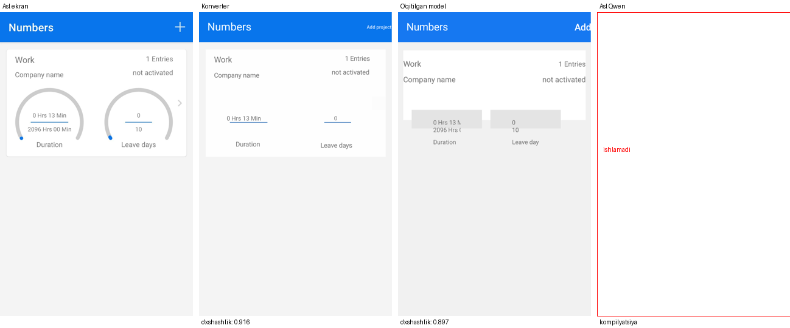

# design2code

Telefon ilovasi ekrani rasmidan **Android Jetpack Compose** kodini yozadigan kichik model.
Bu shaxsiy tajriba loyihasi: ma'lumot topish, tozalash, o'qitish uchun misollar yasash, modelni o'qitish va sinash
jarayonini boshidan oxirigacha o'z kompyuterimda (RTX 4060, 8 GB) qilib ko'rish.

*English: a small vision-language model (Qwen3.5-4B + QLoRA) that turns an Android app screenshot into
Jetpack Compose code. A personal learning project covering the whole ML pipeline on a single 8 GB GPU.*


<sub>Chapdan: asl ekran · qoidaga asoslangan konverter · o'qitilgan model · o'qitilmagan Qwen</sub>

## Natija

Model o'qitishda ko'rmagan **200 ta ekran** (200 xil ilova) ustida sinaldi:

| | Kod kompilyatsiya bo'ldi | Rasmga o'xshashlik (o'rtacha) | Matnlar topildi |
|---|---|---|---|
| Qoidaga asoslangan konverter (yuqori chegara) | 100% | 0.80 | 100% |
| **O'qitilgan model (5 000 misol)** | **92%** | **0.43** | **79%** |
| Asl Qwen3.5-4B (o'qitilmagan) | 7.5–10% | 0.01 | 37–60% |

- O'qitilgan modelning 16 ta xatosi: hammasida kod 4096 tokendan oshib, kesilib qolgan.
- Asl Qwen ko'pincha `import` qatorlarini qayta-qayta yozib, aylanib qoladi.
- Kompilyatsiyada barcha modellarga bir xil yengillik berilgan: standart importlar avtomatik qo'shiladi,
  `@Preview` olib tashlanadi, Material3 "experimental" API'lariga ruxsat beriladi.
- Tasodifiy tanlangan 12 ta misol: [`reports/compare/`](reports/compare). To'liq raqamlar:
  [`reports/eval_compare.json`](reports/eval_compare.json).

**Kamchiliklar (rostini aytganda):**
- Kod "qotirilgan" uslubda: har bir element aniq o'lcham va joy bilan (`size(338.dp, 37.dp)`).
  Model buni konverterdan o'rgangan. Boshqa o'lchamdagi ekranda joylashuv buziladi.
- Rasmlar va belgilar o'rniga rangli qutilar qo'yiladi.
- "O'xshashlik" o'lchovi ba'zan qattiqqo'l: ko'zga o'xshash ekran ham past baho olishi mumkin.

## Qanday ishlaydi

```
MobileViews (122 301 ekran: rasm + view hierarchy)
  │  scripts/clean.py          tozalash → 81 048 ekran, 3 722 ilova
  ▼
  │  scripts/vh2compose.py     view hierarchy → Compose kodi (qoidaga asoslangan konverter)
  │  scripts/run_batch.py      Gradle + Paparazzi: kodni kompilyatsiya qilib, rasmga chizish
  ▼
80 726 juftlik: (asl rasm, Compose kodi, chizilgan rasm, o'xshashlik)
  │  scripts/make_sft_split.py 5 000 ta o'qitish + 200 ta sinov (ilovalar kesishmaydi)
  ▼
  │  scripts/train_sft.py      Qwen3.5-4B, QLoRA (4-bit, r=16), 625 qadam, 3.8 soat (RTX 4060)
  ▼
  │  scripts/eval_model.py     kod yozdirish → kompilyatsiya → render → o'xshashlik
  ▼
Natija jadvali
```

Ma'lumot: [MobileViews](https://huggingface.co/datasets/mllmTeam/MobileViews) (MIT), faqat bitta
qismi (400000–522301) ishlatilgan. O'qitish uchun boshqa AI modellar yozgan kod **ishlatilmagan**:
barcha misollarni qoidaga asoslangan konverter yozgan.

## O'rnatish

Kerak: Linux (x86_64), NVIDIA GPU (8 GB+), Python 3.11+, `curl`, `unzip`, ~25 GB bo'sh joy.

```bash
git clone https://github.com/q0d1r0v/design2code.git
cd design2code
./setup.sh
```

`setup.sh` hammasini o'zi o'rnatadi (sudo kerak emas): Python kutubxonalari, Java 17, Android SDK (yo'q bo'lsa),
Qwen3.5-4B asosiy modeli (~9.3 GB) va o'qitilgan adapter
([Releases](https://github.com/q0d1r0v/design2code/releases)). Qayta ishga tushirsa bo'ladi: tayyor qismlar o'tkazib yuboriladi.

## Sinab ko'rish

```bash
./sinash.sh sinov_rasmlar/ekran1.jpg
```

Natija `natija/` papkasida chiqadi:
- `ekran1.kt` — model yozgan kod;
- `ekran1_solishtirish.png` — chapda asl rasm, o'ngda kod chizgan ekran.

`sinov_rasmlar/` ichidagi 5 ta rasmni model o'qitishda ko'rmagan. O'z rasmingizni ham berishingiz mumkin
(telefon ekrani, tik holatda). Bitta rasmga 1–3 daqiqa ketadi.

## Qaytadan o'qitish (ixtiyoriy)

```bash
scripts/download_mobileviews.sh                 # ~16 GB
.venv-train/bin/python -I scripts/clean.py
scripts/run_all.sh                              # 80K juftlik, bir necha soat
.venv-train/bin/python -I scripts/make_sft_split.py
scripts/train_loop.sh                           # ~4 soat (RTX 4060), uzilsa davom etadi
scripts/eval.sh gen   --name sft5k --adapter runs/sft_5k/final --batch 8
scripts/eval.sh score --name sft5k
```

## Litsenziya

Kod: MIT. Asosiy model: [Qwen3.5-4B](https://huggingface.co/Qwen/Qwen3.5-4B) (Apache 2.0).
Ma'lumot: MobileViews (MIT); ekran rasmlari uchinchi tomon ilovalariga tegishli.
